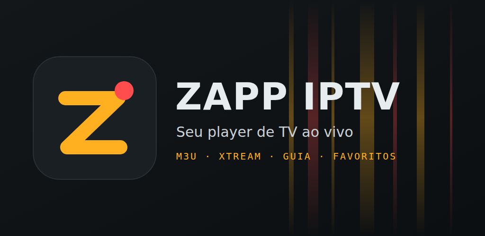

<p align="center"></p>

<h1 align="center">Zapp IPTV</h1>

<p align="center">Player IPTV para as suas listas M3U e Xtream, no navegador, na TV LG, no computador e no celular.</p>

<p align="center"></p>

## Plataformas

| Plataforma | Onde fica | Formato |
|---|---|---|
| Navegador | `iptv-player.html` | abre direto, sem instalação |
| TV LG (webOS) | [`apps/tv-webos`](apps/tv-webos/README.md) | `.ipk` |
| Windows e Linux | [`apps/desktop`](apps/README.md) | `.exe` / `.zip`, `.AppImage`, `.deb` (Electron) |
| Android e iOS | [`apps/mobile`](apps/README.md) | `.apk` / `.aab`, projeto Xcode (Capacitor) |

Todas usam o mesmo código: `tools/bundle.mjs` monta o player web para cada plataforma e
acrescenta os ajustes de cada uma (controle remoto na TV, CORS liberado no desktop, botão
Voltar e requisições nativas no celular).

## Recursos

- Listas **Xtream Codes** (servidor, usuário e senha), **URL M3U** ou **arquivo .m3u**
- Lista de exemplo com canais abertos e públicos, transmitidos gratuitamente pelos próprios canais
- TV ao vivo, filmes e séries, com guia de programação (EPG) e catch-up
- Cartão do canal no player com o programa atual, o tempo restante e o próximo
- Favoritos, canais recentes e "Continuar assistindo" (inclusive por episódio)
- Reconexão automática quando o sinal trava; espera servidores lentos e oferece a versão HD/SD do canal
- Controle parental com PIN e bloqueio/ocultação de categorias
- Tema claro, escuro ou automático, com layout para TV, computador e celular
- Navegação por controle remoto e atalhos de teclado (setas, números do canal, F, M, L, G)

## Usar no navegador

Abra o `iptv-player.html` (Chrome ou Edge recomendados). A lista de exemplo já abre sozinha;
para adicionar a sua, vá em **Configurações**. Tudo fica salvo só no navegador (`localStorage`).

> Por causa de CORS, alguns servidores só funcionam com a página aberta direto do arquivo
> (`file://`) ou de `http://`, e páginas em `https://` não tocam conteúdo `http://`.
> Os apps de desktop e celular não têm essa limitação.

## Gerar os apps

Instale as dependências uma vez, na raiz (Node 22 ou mais novo):

```bash
npm install
```

| App | Comando | Guia |
|---|---|---|
| TV LG | `npm run package -w apps/tv-webos` | [apps/tv-webos/README.md](apps/tv-webos/README.md) |
| Linux | `npm run dist:linux -w apps/desktop` | [apps/README.md](apps/README.md) |
| Windows | `npm run dist:win -w apps/desktop` | [apps/README.md](apps/README.md) |
| Android | `npm run android:apk -w apps/mobile` | [apps/README.md](apps/README.md) |
| iOS | `npm run ios:sync -w apps/mobile` (no Mac) | [apps/README.md](apps/README.md) |

O workflow [`build-apps.yml`](.github/workflows/build-apps.yml) gera o instalador do Windows,
os pacotes de Linux, o APK e um build de verificação do iOS no GitHub Actions
(aba **Actions** → **Build dos apps** → **Run workflow**, ou criando uma tag `v*`).

Material para publicar na Google Play (imagens, textos, formulários e passo a passo):
[store/play/README.md](store/play/README.md).

## Estrutura

Monorepo organizado por funcionalidade: o código do player fica em `src/` (camadas `core`,
`data`, `ui` e uma pasta por funcionalidade em `features/`) e cada plataforma em `apps/`.
Detalhes e regras de onde colocar código novo em [src/README.md](src/README.md).

```
iptv-player.html     entrada do player (carrega o CSS e os scripts de src/ na ordem certa)
src/
  core/              base: utilidades, estado global, tema
  data/              fontes de dados: lista padrão, M3U, Xtream, guia (EPG)
  ui/                peças visuais comuns: ícones, abertura, cabeçalho, diálogos
  features/          home, playlists, section, details, player, settings (tela + lógica)
  styles/style.css   tokens de cor, temas e layouts (computador, TV e celular)
  main.js            ponto de partida
apps/
  tv-webos/          app para TV LG (webOS)
  desktop/           app para Windows e Linux (Electron)
  mobile/            app para Android e iOS (Capacitor)
tools/bundle.mjs     monta o player para as plataformas de apps/
brand/               ícones da marca (app e TV)
listas/              lista de exemplo com canais abertos e públicos
store/               material das lojas (play/ e lg/)
.claude/             agentes e skills do Claude Code para este projeto
```

Bibliotecas: [hls.js](https://github.com/video-dev/hls.js) e [mpegts.js](https://github.com/xqq/mpegts.js)
(via CDN no navegador; embutidas nos apps).

## Privacidade e conteúdo

O Zapp IPTV não coleta dados: listas, credenciais, favoritos e histórico ficam só no aparelho.
Veja a [política de privacidade](https://teysonlorenzon.github.io/canal-livre-iptv/store/play/politica-de-privacidade.html).

O app não fornece, vende nem hospeda conteúdo; ele reproduz as listas que você adiciona.
Use somente listas e serviços aos quais você tem direito de acesso.
